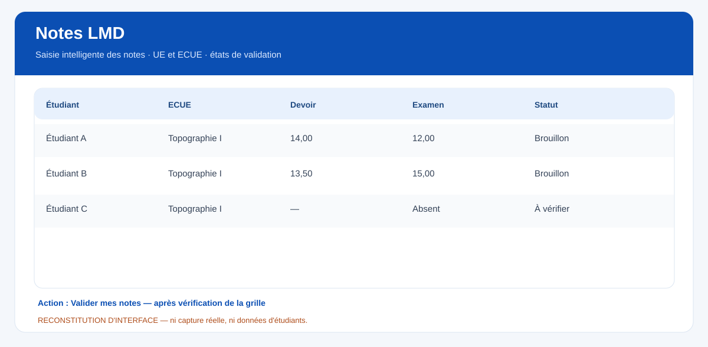
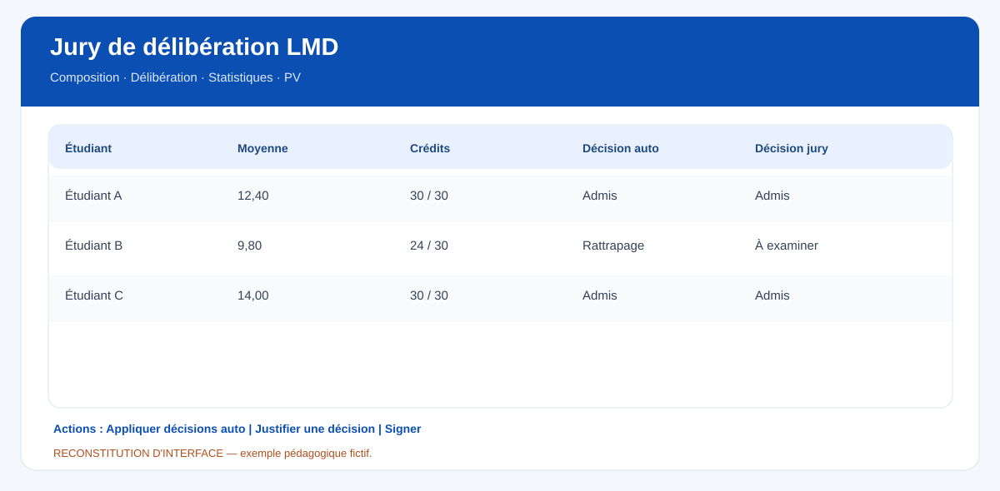
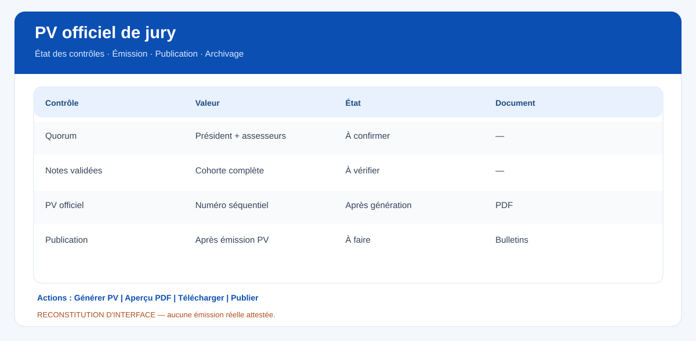

# KLASSCI — Guide métier LMD : de la maquette aux PV et relevés
**Édition 1.0 — 29 octobre 2026** · **Public :** scolarité, direction des études, enseignants, responsables UE, secrétaires et présidents de jury.

> **Méthode et limites :** guide établi sur la lecture des vues et contrôleurs de la branche `presentation` et sur les textes officiels. Les trois illustrations jointes sont des **reconstitutions d'interface**, pas des captures connectées. Ne pas considérer ce guide comme une validation de production avant la recette E2E par établissement.

## Enchaînement complet
`Classes et inscriptions → Maquette UE/ECUE/CECT → Planning / Examens → Notes brouillon → Notes validées → Session / rattrapage → Pré-jury → Délibération → Signatures → PV officiel → Publication → Bulletin et relevé → Réclamations / rectificatifs → Clôture`.

### Scolarité : préparer l'année
1. Créer la classe LMD avec **domaine, mention, parcours, niveau, capacité, année** puis valider les inscriptions actives. Vérifier les réinscrits et les transferts.
2. Sous **Planning LMD**, choisir parcours/niveau/semestre et contrôler UE, ECUE, crédits, coefficients, horaires CM/TD/TP et enseignants responsables. Pour une Licence, L1 = S1/S2, L2 = S3/S4, L3 = S5/S6. Vérifier les **30 CECT par semestre**.
3. Faire approuver les modalités de contrôle des connaissances : pondération CC/examen, compensation, arrondis, absences, note plancher, rattrapage et passage. **Ne pas substituer les defaults applicatifs au règlement local.**
4. Ouvrir le **Pilotage académique** pour repérer les lacunes de la cohorte, si l'écran et les permissions sont disponibles.

### Service examens : relier les épreuves aux notes
1. Ouvrir **Examens** : vérifier année, classe, type, session, dates, salles, surveillants.
2. Depuis une épreuve, utiliser **Ouvrir la feuille de notes**. Si examen anonyme, saisir par **numéro de copie** ; ne pas contourner la levée d'anonymat.
3. Après réception et contrôle, faire verrouiller les feuilles d'épreuve selon les droits ; documenter tout incident et absence.

### Enseignant / responsable UE : saisir, vérifier, valider

1. Ouvrir **Notes LMD**, sélectionner l'année puis la classe.
2. Dans **Saisie intelligente des notes**, choisir **UE**, **ECUE**, **période**, puis créer l'évaluation si nécessaire : Devoir/Examen/Contrôle/TP/Projet, barème et coefficient.
3. Saisir les notes ; distinguer **absence**, **0** et **non saisi**. Relire la grille et les moyennes.
4. Les notes sont d'abord en **brouillon**. Cliquer sur **Valider mes notes** et contrôler l'état effectif avant de sortir.
5. Toute correction après verrou requiert l'autorisation et la trace correspondantes. Ne jamais éditer hors circuit officiel.

### Scolarité : deuxième session
1. Dans **Sessions & Rattrapage LMD**, ouvrir la session normale terminée et la session enfant de rattrapage (la liaison est indispensable).
2. Identifier les ECUE et étudiants éligibles selon les règles de l'établissement.
3. Organiser les examens, saisir la note de session 2, puis **recalculer**.
4. Vérifier le réglage de la règle **max ou remplacement** et sa conformité au règlement ; contrôler les moyennes et crédits recalculés avant publication.

### Jury : décider sans ambiguïté

1. Ouvrir **Jurys de délibération LMD → Nouveau jury** ; choisir classe/parcours, semestre, session et date.
2. Onglet **Composition** : saisir président, assesseurs, secrétaire, présences, signatures et quorum.
3. Onglet **Délibération** : cliquer **Appliquer décisions auto** si les feuilles sont complètes ; vérifier moyenne, crédits, proposition et décision effective **étudiant par étudiant**.
4. Si la décision du jury diffère de la proposition, la **motiver**, et documenter le vote si nécessaire.
5. Le bandeau **Prêt pour le procès-verbal** doit être vert. Sinon traiter **chaque prérequis** affiché. Cliquer **Générer PV** seulement après la revue collégiale.

### PV, publication, bulletins et relevés

1. Utiliser **Aperçu PDF du PV officiel** ; contrôler identité de l'établissement, année, semestre, session, matricules, crédits, décisions, signatures et numéro.
2. **Télécharger le PV officiel (PDF)** et archiver l'acte. Le registre contient numéro, référence, statut, version et empreinte de contrôle.
3. Cliquer **Publier les décisions** puis **Voir les bulletins de ce jury**. Dans **Résultats LMD / Bulletins**, comparer les résultats publiés au PV et contrôler les absences de bulletin.
4. Émettre et délivrer le **relevé LMD** avec les permissions autorisées ; vérifier sa concordance avec les documents de jury. Les anciens actes doivent rester figés.
5. Après publication, traiter une réclamation par workflow de correction autorisée, puis **Émettre un PV rectificatif** si nécessaire. **Ne jamais réécrire silencieusement l'ancien PV.**
6. En fin de Licence/Master : vérifier attestation, diplôme, supplément au diplôme et éventuelles équivalences. **Ces sorties ne sont pas toutes prouvées par la lecture actuelle du dépôt.**

## Contrôle final à cocher en recette
- [ ] Maquette exacte par parcours et 30 CECT/semestre
- [ ] Cohorte des inscrits complète
- [ ] CC et examen correctement pondérés selon le règlement
- [ ] Absences et feuilles non validées bloquent les opérations irréversibles
- [ ] Rattrapage correctement relié et calculé
- [ ] Quorum et signatures contrôlés
- [ ] PV semestriel et annuel exacts, numérotés, PDF téléchargeables
- [ ] PV = décisions = bulletins = relevés = crédits
- [ ] Correction post-PV traçable, version rectificative conservée
- [ ] Permissions et tests mobiles contrôlés par service

## Liens vers le code
- `resources/views/esbtp/lmd/notes/index.blade.php`
- `app/Http/Controllers/ESBTPLMDNoteController.php`
- `resources/views/esbtp/lmd/jurys/partials/`
- `app/Services/JuryDeliberationService.php`
- `docs/api/{EXAMENS_LMD,RATTRAPAGE_LMD,JURY_DELIBERATION}.md`
- `app/Domain/OfficialDocuments/Http/LmdTranscriptController.php`

## Textes et comparateurs
- [UEMOA, Directive 03/2007/CM/UEMOA](https://www.e-docucenter.uemoa.int/fr/directive-ndeg032007cmuemoa-portant-adoption-du-systeme-licence-master-doctorat-lmd-dans-les).
- [CAMES, Référentiel SI, sections B.6–B.8](https://www.lecames.org/wp-content/uploads/2019/06/Referentiel-developpement-SI-CAMES.pdf).
- [Côte d'Ivoire, arrêté Licence du 13 décembre 2011](https://uvci.online/fr/__pdf/textes/7%20Arrete%20LICENCE%20du%2013%20dec%202011%20MESRS.pdf).
- [Côte d'Ivoire, arrêté Master du 13 décembre 2011](https://www.uvci.edu.ci/fr/__pdf/textes/6%20Arrete%20MASTER%20du%2013%20dec%202011%20MESRS.pdf).
- [Sorbonne Nouvelle — parcours APOGÉE notes et résultats](https://www.sorbonne-nouvelle.fr/module-gestion-des-notes-et-des-resultats-888168.kjsp).

**Attention** : aucun test fonctionnel authentifié, aucun PV de démonstration émis et aucune capture réelle de production ne sont attestés par cette édition. Les modèles/règles se valident établissement par établissement.
